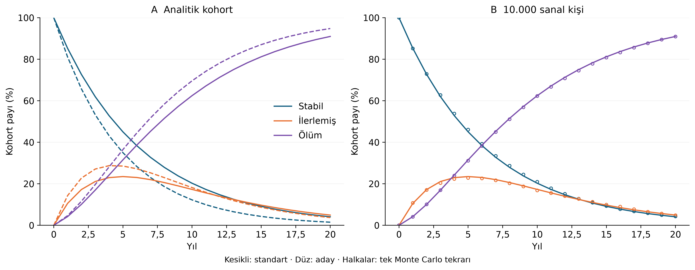

# Türkiye ilaç ekosistemi simülasyonları

Makalenin bütçe etkisi, maliyet-yararlılık, Ar-Ge ve portföy hesaplarını yeniden üreten Python araştırma paketi. **Depo özeldir; henüz açık erişimli bir kod yayını değildir.** Makale yazarlığı: Umut Şimşekçi ve Yıldırım Cesaretli, SBÜ Gülhane Tıp Fakültesi, Tıbbi Farmakoloji ABD. Bildirilen finansal destek ve çıkar çatışması yoktur.

Karar modelleri **varsayımsal** ve hastalık/ürün düzeyinde kalibre edilmemiştir. Açık kaynaklardan derlenen gözlem göstergeleri `data/observed/` içinde ayrı tutulur. Simülasyon çıktıları ulusal tasarruf, klinik etkililik veya yatırım başarısının kanıtı değildir.



## Başlangıç

Python 3.12 önerilir. Komutları depo kökünde çalıştırın.

```powershell
python -m venv .venv
.venv\Scripts\python -m pip install -e ".[app,dev]"
.venv\Scripts\python -m pharmacoecosim.run
.venv\Scripts\python -m streamlit run app.py --server.address 127.0.0.1
```

Linux/macOS üzerinde `.venv\Scripts\python` yerine `.venv/bin/python` kullanın. Hesaplama internet erişimi gerektirmez; ilk bağımlılık kurulumu gerektirir.

- **Parametre değiştirme:** Streamlit ekranında fiyat, gecikme, aday etki oranı, ufuk, risk ve bütçeyi değiştirin. Her değişiklik ilgili modeli yeniden hesaplar.
- **Çevrimdışı inceleme:** Tam çalıştırma sonrası `results/interactive/simulasyonlar.html` dosyasını tarayıcıda açın. Grafikleri yakınlaştırın ve kohort animasyonunu oynatın. Bu dosya önceden hesaplanan sonuçları gösterir; yeni ekonomik hesap yapmaz.
- **Toplu senaryo:** `config/paper.json` kopyasını düzenleyin ve `python -m pharmacoecosim.run --config config/benim_senaryom.json --out results/alternatif` çalıştırın.
- **Öğrenme ve yeniden çalıştırma:** `notebooks/01_model_simulasyonlari.ipynb` dört modeli adım adım açıklar.
- **Test:** `python -m pytest -q`.

PSA, makale sonuçlarıyla birebir karşılaştırma amacıyla sabit makale dağılımlarını kullanır. CLI'da veya ekranda deterministik parametrelerin değiştirilmesi bu dağılımları yeniden kalibre etmez. Varsayılan dışı dağılımlar için `probabilistic` fonksiyonları ve parametre belgesi birlikte değiştirilmelidir.

## Beklenen temel sonuçlar

| Hesap | Temel senaryo |
|---|---:|
| Beş yıllık ek bütçe | −1,680 milyar TL |
| İskontolu ek bütçe | −1,331 milyar TL |
| Başabaş net fiyat farkı | %14,5 |
| İki yıl gecikmede ek bütçe | +0,620 milyar TL |
| Ek QALY / kişi | 0,672870 |
| ICER | 491.323 TL/QALY |
| Tek Ar-Ge adayı rNPV | 0,837792 milyar TL |
| 8 milyar TL bütçede seçim | G + B + N1 + P |
| Seçilen portföy yatırımı | 7,4 milyar TL |

20.000 çekiliş ve `20260922` tohumu kullanılır. Sanal hasta ve aday süreç simülasyonları için ayrı tohum `20261012`'dir. Aralıklar varsayılan parametre belirsizliğini temsil eder; gözlemsel güven aralıkları değildir. Tam sonuçlar `results/summary.json`; sabit 2025 TL birimi kullanılır, Ar-Ge/portföy/toplam bütçe milyar TL, kohort kişi başına TL olarak raporlanır.

## Dosya haritası

| Konum | İşlev |
|---|---|
| `src/pharmacoecosim/` | Ayrı bütçe, kohort, Ar-Ge, portföy, görselleştirme modülleri |
| `config/paper.json` | Deterministik girdiler, tohumlar ve çekiliş sayısı |
| `docs/MATEMATIK.md` | Denklemler, zamanlama, varsayımlar ve yorum sınırları |
| `docs/PARAMETRELER.csv` | Girdi, birim, dağılım ve varsayım kaydı |
| `docs/MAKALE_ESLESTIRMESI.md` | Makale–kod–çıktı eşleştirmesi |
| `docs/KAYNAKLAR.md` | Kaynak künyeleri ve yazılım belgeleri |
| `results/figures/` | Altı yeni şekil; 320 dpi PNG, vektörel PDF ve SVG |
| `results/data/` | Grafik verileri ve tablo çıktıları |
| `results/animations/kohort.gif` | Oluşturulan kohort animasyonu |
| `tests/fixtures/paper_results.json` | Önceki makalenin referans sayıları |
| `manuscript/` | Kod bağlantısı eklenmiş makale ve matematiksel simülasyon eki |

Büyük çekiliş CSV'leri, çevrimdışı HTML ve GIF tam komutla yeniden oluşturulur; Git geçmişine eklenmez. Test edilmiş doğrudan bağımlılıklar `requirements-tested.txt`, tam yerel ortam `docs/environment.txt` içindedir. GitHub Actions her kod değişiminde hesap ve arayüz testlerini çalıştıracak biçimde yapılandırılmıştır. İşletim sistemi ve kütüphane farkları nedeniyle kayan nokta toleransları kullanılır.

Yayın aşamasında depo görünürlüğü ve yeniden kullanım lisansı ayrıca kararlaştırılacaktır. Şu anda açık kaynak lisansı atanmadı. Dergiye gönderim yapılmadı.
